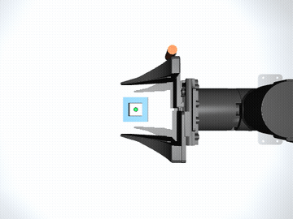

# yam-peg-insert

<p align="center">
  
</p>

<p align="center">
  <sub>ACT + Temporal Ensembling 在本地 CPU 上闭环完成插销（v1 场景，seed 0，142 步）· <a href="docs/media/act_success.mp4">MP4</a></sub>
</p>

基于 Google DeepMind [MuJoCo Menagerie](https://github.com/google-deepmind/mujoco_menagerie)（`i2rt_yam`）与 `mujoco.MjSpec` 构建的 **YAM 机械臂精密插销（Peg-in-Hole）** 项目。

覆盖完整链路：**仿真环境 → 雅可比 IK 示教 → LeRobot 数据集 → Kaggle/Colab GPU 训练 ACT → 本地 CPU 闭环评测**。

## 实测结果（严格判据）

> 下表为 **v1 场景**（commit `1a27fa6`：孔座未抬高）的实测。当前默认场景已按 v3 把孔座抬高 1 cm，指标待重训后更新。

成功判定（`env.py`）同时满足：

- 横向偏差 `|dx|, |dy| < 5.5 mm`（孔宽 36 mm、销径 24 mm，物理单边间隙 6 mm）
- 纵向偏差 `-4 mm < dz < 6 mm`
- 插销轴保持竖直（`|z_axis| > 0.92`）

| 策略 / 推理配置 | 评测方式 | 成功率 | 成功耗时 | 主要失败 |
|---|---|---|---|---|
| 脚本 IK 专家（`oracle.py`） | 本地 CPU，50 seeds | **49/50（98%）** | 约 140 步 | — |
| ACT，100 步/次重规划 | 本地 CPU，50 seeds | 15/50（30%） | 144 ± 2 步 | 31 孔沿卡死、4 倾倒 |
| ACT，10 步/次重规划 | 本地 CPU，50 seeds | 7/50（14%） | — | 35 超时、8 倾倒 |
| **ACT + Temporal Ensembling（0.01）** | 本地 CPU，50 seeds | **33/50（66%）** | 143.8 步 | 11 孔沿卡死、6 倾倒 |

孔壁高 40 mm，成功时插销插入深度约 **3 cm**。成功轨迹的销尖误差 2.6–7.9 mm。

结论：100 步开环动作块是主要瓶颈；改用逐帧推理 + 时间集成（不重训）即可把成功率翻倍。把块长直接切到 10 步反而更差（块间跳变导致抖动），该负结果保留在脚本参数中以便复现。

剩余失败仍集中在孔口：`11/50` 的销尖停在孔口上方 4–5 cm 并压住孔沿（`ncon≈22`），`6/50` 插销倾倒。失败姿态下 `joint4` 已顶到 1.571 rad 限位。

## 项目结构

```text
src/yam_peg_insert/
  scene.py        # MjSpec 拼接 i2rt_yam、工作台、凸多边形孔座、插销
  env.py          # Gymnasium 环境（33 维观测 / 7 维动作 / 成功与失败判定）
  oracle.py       # 6-DoF 位姿 IK 示教专家（悬停→夹取→提起→跨越→插入）
scripts/
  run_oracle.py               # 运行专家并可选录制 .npz
  replay_demo.py              # 回放 .npz（可选交互窗口）
  convert_demos_to_lerobot.py # 成功轨迹 → LeRobotDataset（含 overhead_cam 视频）
  eval_policy.py              # ACT 本地 CPU 闭环评测
  view_scene.py               # MuJoCo 交互式查看
  smoke_test.py               # 无头物理冒烟测试
notebooks/train_colab_act.ipynb
docs/media/act_success.{gif,mp4}
tests/test_env.py
```

## 1. 环境

Ubuntu 22.04 + Python 3.12，`uv` 隔离环境不影响 ROS 2 Humble 的系统 Python：

```bash
bash scripts/setup_ubuntu22.sh
source .venv/bin/activate
```

评估 ACT 需要额外安装 LeRobot（会带入 torch；Linux 默认 wheel 自带 CUDA 运行时，无 GPU 时自动走 CPU）：

```bash
uv pip install -e ".[act]"
```

## 2. 本地 CPU 常用命令

```bash
python scripts/smoke_test.py            # 无头物理冒烟测试
python scripts/view_scene.py            # MuJoCo 交互窗口（空格暂停，Esc 退出）
python scripts/run_oracle.py --episodes 3 --record   # IK 专家演示并录制到 demos/
pytest                                  # 单元测试
```

无独显时若 OpenGL 报错：`export LIBGL_ALWAYS_SOFTWARE=1`。

## 3. 数据集与训练

- 数据集：[`dream0906/yam-v3`](https://huggingface.co/datasets/dream0906/yam-v3)，50 条纯净直插轨迹、6,864 帧、25 fps，包含 `observation.state`(33)、`action`(7) 与 `overhead_cam` 视频（360×480）。
- 转换：`python scripts/convert_demos_to_lerobot.py --demos-dir demos_v3 --repo-id dream0906/yam-v3 --root datasets/yam_v3 --overwrite --push-to-hub`
- 训练：Kaggle T4 打开 [notebooks/train_colab_act.ipynb](notebooks/train_colab_act.ipynb)，ACT 训练 30k steps、batch 8、chunk 100（与 v1 同配置，便于只对比场景差异）。
- 产物：`outputs/train/act_yam_peg/checkpoints/last/pretrained_model/`（`config.json`、权重与 pre/post-processor）。

## 4. 本地 ACT 闭环评测

```bash
# 推荐：逐帧时间集成（Temporal Ensembling）
python scripts/eval_policy.py \
  --checkpoint /path/to/act_yam_peg/checkpoints/last/pretrained_model \
  --episodes 50 --te-coeff 0.01

# 对照：checkpoint 默认的 100 步开环重规划
python scripts/eval_policy.py --checkpoint /path/to/... --episodes 50
```

脚本会逐帧渲染 `overhead_cam`、把 checkpoint 里写死的 `cuda` processor 重映射到 CPU，并输出每个 episode 的结果与汇总：

```text
Suite: 50 episodes, 250 max steps/episode
Replanning: temporal ensembling coeff=0.01, 1 action/inference
Success rate: 33/50 (66%)
Mean success steps: 143.8
Outcomes: {'success': 33, 'timeout': 11, 'tipped': 6}
```

`--n-action-steps N` 可切换成每 N 步重规划（用于复现 14% 的负结果）。

## 5. 环境设计

- **观测（33 维）**：7 维关节目标 + 8 维机器人关节位置 + 8 维速度 + 夹取点到插销向量(3) + 销尖到孔底向量(3) + 插销 z 轴(3) + 接触数(1)。
- **动作（7 维）**：6 个机械臂关节 + 夹爪，`[-1, 1]` 增量 × 0.05 叠加到上一拍目标并做关节限位裁剪。
- **复位**：使用模型 `home` keyframe，夹爪张开，插销初始位置随机 ±2 cm。
- **孔座**：抬高 1 cm（带底座垫块），给插入阶段的 `joint4` 留余量；插销放在 `x=0.31 m`。
- **终止**：成功（严格判据）、插销掉落/倾倒、或达到 250 步。

## 6. 已知限制

- 即使启用 TE，仍有 22% 的 episode 卡在孔口或倾倒：策略缺少接触柔顺，压住孔沿后不会回退重试（v1 实测）。
- v3 示教为 120 条**纯净直插**，初始位置随机 ±2 cm；没有失败恢复片段。
- `joint4` 全程峰值出现在 grasp/lift（约 1.55 rad），插入阶段峰值 1.27–1.32 rad；采数时按插入阶段 < 1.48 rad 过滤。
- 训练权重不随仓库分发，需按第 3 节自行训练或放置 checkpoint。

## 致谢

场景与机器人模型来自 [MuJoCo Menagerie](https://github.com/google-deepmind/mujoco_menagerie) 的 `i2rt_yam`；数据集格式与训练、评测流程基于 [LeRobot](https://github.com/huggingface/lerobot)。
